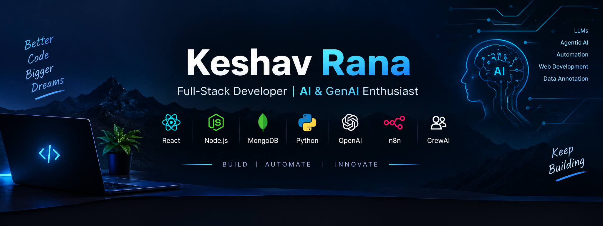

  

  

  
  

---

# 👋 Hey, I'm Keshav Rana

### Data Annotator @ Qualitas Global | Full-Stack Developer | AI & GenAI Enthusiast

🎓 **B.Tech in Computer Science and Engineering** — Central University of Jammu

💼 **Currently:** Data Annotator at Qualitas Global  
📍 Pune, India

I'm a Computer Science and Engineering student and technology enthusiast passionate about building scalable web applications, intelligent AI-powered solutions, and automated workflows.

My experience spans full-stack web development, AI-powered automation, data annotation, and working with modern AI tools. Through my internships and projects, I've explored how software engineering and artificial intelligence can solve real-world problems.

I enjoy learning new technologies, building practical projects, and continuously improving my software development and AI engineering skills.

---

## 💼 Current Position

**Data Annotator — Qualitas Global**

*October 2026 – Present*

- Working in the data annotation domain.
- Developing familiarity with data labeling and annotation workflows.
- Applying attention to detail and consistency to annotation tasks.

## 🎓 Education

**Bachelor of Technology (B.Tech) in Computer Science and Engineering**

Central University of Jammu, India

## 🚀 Internship Experience

### IIT Jammu — Full-Stack Development & Artificial Intelligence

- Explored full-stack web development and AI-powered applications.
- Worked on projects involving OpenAI APIs, Python, and AI-assisted search.
- Gained practical exposure to automation workflows and emerging AI technologies.

### Edunet Foundation — Internship

- Gained practical exposure through internship-based technical learning and project work.

---

## 🛠️ Technical Skills

### Programming Languages

### Full-Stack Development

### Artificial Intelligence & Automation

**Areas of Interest:** Generative AI, Large Language Models (LLMs), Agentic AI, Prompt Engineering, API Integration, AI Agents, Workflow Automation, and Data Annotation.

### Developer Tools

---

## 🚀 Featured Projects

### 1. Skill Sync — MERN Stack Learning Platform

A full-stack learning platform that connects people who want to learn skills with people who can teach them.

- User authentication and profiles.
- Skill matching based on learning and teaching preferences.
- Learning requests, communication, scheduling, and reviews.
- Admin panel for user and platform management.

**Tech Stack:** React.js, Node.js, Express.js, MongoDB

### 2. Student Performance Monitor — n8n Automation

An automated workflow that processes student marks, classifies performance, generates reports, and sends notifications.

- Retrieves student data from Google Sheets.
- Processes marks using predefined thresholds.
- Generates CSV reports and supports Slack and email notifications.

**Tech Stack:** n8n, Google Sheets, Slack, Workflow Automation

### 3. Browser Search Bot — AI-Powered Search Assistant

An interactive application that retrieves web search results and uses an AI model to summarize relevant information.

- Fetches search results through the Serper API.
- Summarizes findings using the OpenAI SDK.
- Provides an interactive interface with Gradio.

**Tech Stack:** Python, Serper API, OpenAI SDK, Gradio

### 4. Local AI Digest — Multi-Agent News System

An AI project focused on gathering and summarizing news using a multi-agent workflow.

- Explores task delegation between AI agents.
- Uses CrewAI to coordinate an automated news-digest workflow.

**Tech Stack:** Python, CrewAI, Agentic AI

---

## 📊 GitHub Analytics

---

## 🌐 Let's Connect

---

### 💡 My Goal

To grow as a software engineer by combining full-stack development, artificial intelligence, and automation to build useful, scalable, and intelligent solutions.

⭐ *Keep learning. Keep building. Keep growing.*
